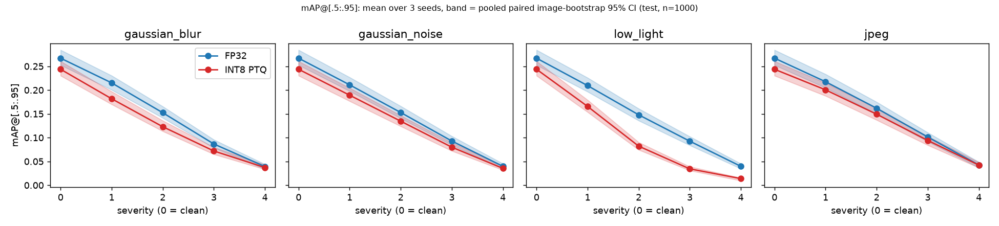
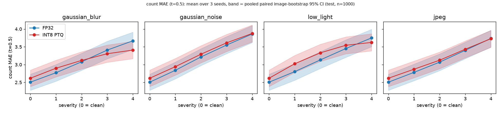
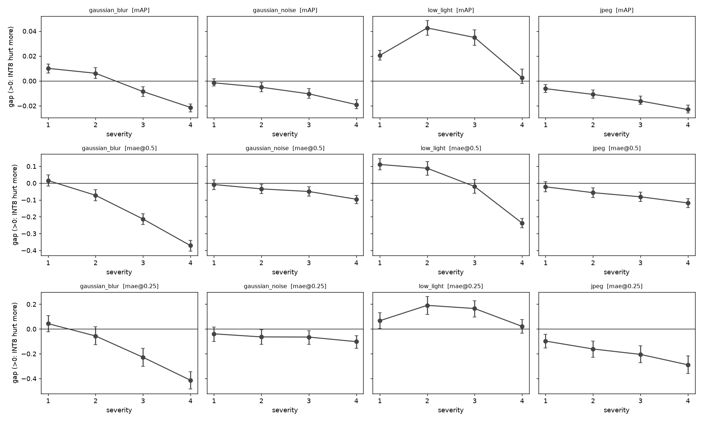
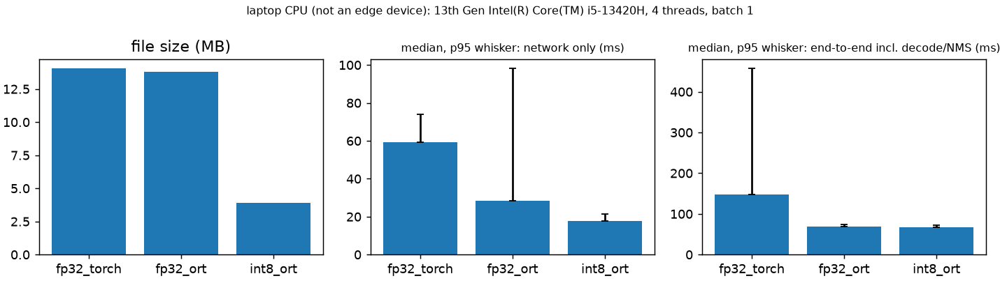
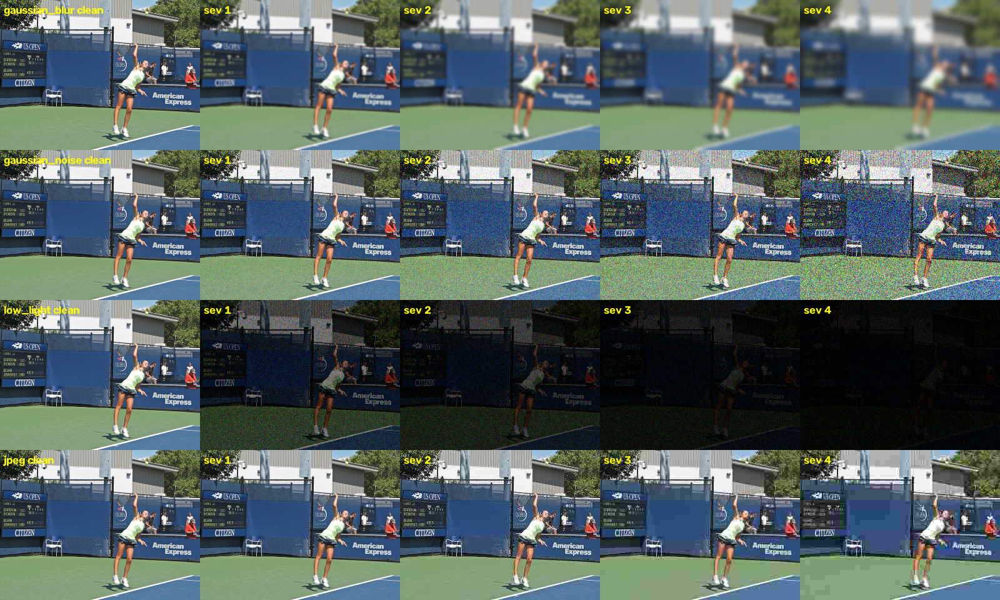

<div align="center">

# 🔍 Squint

### Does shrinking a detector to INT8 make it more fragile on blurry, noisy, dark images?

A small, pre-registered, reproducible study of **INT8 quantization** and **image-corruption robustness**<br>
for a lightweight people detector and counter.


-informational)
-success)

[TL;DR](#-tldr) · [Results](#-headline-result) · [Method](#-method) · [Reproduce](#-reproduce) · [Limitations](#-limitations)

</div>

---

## 📌 TL;DR

| | |
|---|---|
| **Question** | Does INT8 quantization hurt robustness to corruptions *more* than it hurts clean accuracy? |
| **Model** | torchvision SSDLite320 MobileNetV3-Large, fine-tuned on COCO `person` |
| **Compression** | Post-training INT8 quantization, run on real INT8 kernels (ONNX Runtime, CPU) |
| **Stress tests** | Blur, noise, low light, JPEG, each at 4 severities (17 conditions with clean) |
| **Answer** | **Not supported** under the pre-registered rule. Mixed: extra loss in low light at severities 1-3, nothing beyond the clean loss elsewhere. |
| **Not done** | QAT (quantization-aware training) was **not run**. Only PTQ was tested. |

> **The evaluation is the product.** Exporting and quantizing a model is routine. This repo's value is the careful measurement: fixed seeds, committed splits, paired bootstrap confidence intervals, and hypotheses written down *before* any experiment ran.

## 🧒 New here? Plain-English glossary

| Term | Meaning |
|---|---|
| **Object detector** | A model that draws boxes around things in an image. Here, people. |
| **Counting** | Number of person boxes the model keeps above a confidence threshold, compared with the true count. |
| **Quantization (INT8)** | Storing the model's numbers as 8-bit integers instead of 32-bit floats. Smaller and often faster, possibly less accurate. |
| **PTQ** | Post-training quantization: shrink an already-trained model using a small calibration set. No retraining. |
| **QAT** | Quantization-aware training: train while simulating INT8. Not used in this study. |
| **mAP** | Mean average precision, the standard detection accuracy score (0 to 1, higher is better). |
| **Count MAE** | Average absolute error between predicted and true people count (lower is better). |
| **Corruption** | A synthetic image degradation: blur, noise, darkening, or heavy JPEG compression. |
| **Robustness gap** | `[FP32 − INT8](corrupted) − [FP32 − INT8](clean)`. Above 0 means INT8 loses *extra* accuracy under corruption. |
| **Bootstrap CI** | A 95% confidence interval from resampling test images. If it includes 0, we cannot claim an effect. |

## 📊 Headline result

**H1 is not supported under the pre-registered rule** ([`docs/PREREG.md`](docs/PREREG.md)): no corruption family has a robustness-gap CI entirely above 0 at severities 3 and 4. The result is mixed: INT8 loses extra mAP in low light at severities 1-3, and no more than its clean loss elsewhere. H2 (QAT) was not tested.

Test split, n = 1000 images, 3 training seeds, mean over seeds with pooled paired image-bootstrap 95% CI:

| Condition | FP32 mAP | INT8 mAP | FP32 count MAE @0.5 | INT8 count MAE @0.5 |
|---|---|---|---|---|
| Clean | 0.267 [0.253, 0.284] | 0.244 [0.230, 0.261] | 2.51 [2.28, 2.73] | 2.62 [2.38, 2.85] |
| Low light, severity 4 | 0.040 [0.035, 0.045] | 0.014 [0.010, 0.016] | 3.75 [3.50, 3.99] | 3.62 [3.39, 3.87] |

Robustness gap (mAP) in low light, severities 1-4: **+0.021, +0.043, +0.035, +0.003** (CI at severity 4: [-0.002, +0.010]). Tables for every condition: [`docs/RESULTS.md`](docs/RESULTS.md).

<div align="center">



</div>

<details>
<summary><b>More figures</b></summary>

| Count error vs severity | Robustness gap vs severity |
|---|---|
|  |  |

| Size and latency | Corruption samples |
|---|---|
|  |  |

</details>

## 🧪 Hypotheses

Written in `docs/PREREG.md` before any experiment was run.

- **H1:** The FP32 − INT8 gap grows under corruption relative to clean images.
- **H2:** QAT recovers part of that extra gap. *Not tested.*
- **H0:** The gap is the same or negligible. An equally acceptable result.

## 🛠️ Method

<details open>
<summary><b>Model</b></summary>

torchvision SSDLite320 MobileNetV3-Large, COCO-pretrained, fine-tuned 3 epochs on 2000 train images (3 seeds). Frozen BN, SGD, AMP.

</details>

<details open>
<summary><b>Data</b></summary>

COCO 2017, person only. Splits are seeded id lists committed in `data/splits/`:

| Split | Images | Source |
|---|---|---|
| train | 2000 | train2017 |
| dev | 500 | held-out train2017 (tuning, calibration, thresholds) |
| test | 1000 | val2017, at least one non-crowd person (final runs only) |

Crowd boxes are ignore regions in AP. Count = number of non-crowd person boxes.

</details>

<details open>
<summary><b>Compression (Track B, gate G1)</b></summary>

ONNX export of raw heads (decode and NMS in Python), ONNX Runtime 1.27.0 static INT8 (QDQ), calibration on 100 dev images, per-tensor. Real INT8 execution is verified from the executed graph: 98 QLinearConv, 10 QLinearAdd, 8 QLinearGlobalAveragePool, 8 QLinearMul, 2 QLinearConcat (`results/quant/`).

</details>

<details open>
<summary><b>Corruptions</b></summary>

Deterministic from `(image_id, name, severity, seed)`. Severities were tuned on dev so FP32 mAP falls about 20% of clean per level, then frozen in `configs/eval.yaml` before any test run.

| Family | What it simulates |
|---|---|
| `gaussian_blur` | Out-of-focus / motion softness |
| `gaussian_noise` | Sensor noise |
| `low_light` | Darkening plus shot/read noise |
| `jpeg` | Heavy compression |

</details>

<details open>
<summary><b>Statistics</b></summary>

Paired image bootstrap (one shared resample matrix across models, seeds, conditions), 200 resamples for mAP, 1000 for counts, pooled over seeds. `gap = [FP32 − INT8](corrupt) − [FP32 − INT8](clean)`, sign flipped for count MAE.

</details>

### ⚡ Size and latency

Laptop CPU (13th Gen Intel i5-13420H, 4 threads, batch 1, 20 warm-up, 200 timed runs). **Not an edge device.**

| Variant | Size (MB) | Network median (ms) | End-to-end median (ms) |
|---|---|---|---|
| FP32 torch | 14.05 | 59.4 | 147.7 |
| FP32 ONNX Runtime | 13.82 | 28.4 | 68.3 |
| INT8 ONNX Runtime | 3.91 | 17.7 | 67.9 |

INT8 is 3.5x smaller than FP32 ONNX and 1.6x faster on the raw network, but end-to-end time is unchanged (decode/NMS dominate). Ratios computed from `results/latency.json`.

## 🗂️ Repo map

```
configs/      data, train, quant, eval settings (frozen severities live in eval.yaml)
data/splits/  committed train/dev/test image-id lists
docs/         PREREG.md (hypotheses), DECISIONS.md (gate log), RESULTS.md (all tables)
src/qrd/      data, models, train, quantize, corruptions, metrics, evaluate, stats, report
scripts/      thin CLIs, one per stage
tests/        pytest suite
results/      raw JSON, figures, quantization and latency evidence
Makefile      make data | train | quant | eval | bench | stats | report | test | all
```

## 🚀 Reproduce

Tested on Python 3.12. `requirements.txt` pins the versions that produced the committed results; `requirements-min.txt` is the unpinned short list.

```bash
python -m venv .venv
source .venv/bin/activate           # Windows: .venv\Scripts\activate
pip install -r requirements.txt
python -m pytest -q                 # 21 tests, ~20 s; no GPU or dataset needed

make data                           # downloads the images in data/splits/*.json; needs COCO annotations in data/coco/annotations/
make train                          # resume-able, checkpoints every epoch in data/ckpt/ (gitignored)
make quant eval bench               # ONNX + INT8, the 2 x 17 x 3 test grid, size/latency
make stats report                   # bootstrap CIs, tables, figures
```

**Inspect without re-running anything:** `results/raw/` (103 per-run JSONs), `results/stats.json`, `results/latency.json` and every figure in `results/figures/` are committed.

**Needs compute:** `make stats` rebuilds the confidence intervals from the raw detections in `data/dets/` (221 MB, gitignored), so regenerating them needs `make eval` first. Checkpoints, ONNX files and caches are gitignored too.

> ⚠️ A full fresh-clone reproduction has **not** been run end to end. The test suite passes and the committed results are internally consistent, but the `make all` path from an empty clone is unverified.

## 🔎 Failure analysis

At low light severity 4, INT8 often emits one near-image-sized box where FP32 outputs nothing ([`failure_gallery.png`](results/figures/failure_gallery.png)). The cause was not tested. See [`docs/RESULTS.md`](docs/RESULTS.md).

## ⚠️ Limitations

- One detector architecture and one dataset (COCO person).
- COCO-pretrained weights saw train2017; test uses val2017 only.
- The fine-tuned model is weaker than the pretrained one on dev (0.261 vs 0.290 mAP) and was not retuned.
- Synthetic corruptions, not real sensor noise.
- 3 seeds, 1000 test images, 200 bootstrap resamples for mAP.
- 48 gap CIs without multiplicity correction.
- Latency measured on laptop CPU only.
- PTQ recipe not tuned; no ablations (per-channel, calibration size) run.
- INT8 runtime is ONNX Runtime 1.27.0 (CPU).
- **QAT not measured.**

## 📜 Licenses and data terms

- **Code:** [MIT](LICENSE). Data and weights are covered separately below.
- **COCO:** annotations CC BY 4.0, images per Flickr terms. `UNVERIFIED:` confirm at cocodataset.org/#termsofuse.
- **Weights:** follow torchvision's licensing. `UNVERIFIED:` check the weights license before redistributing.

## 📚 Citations

- Lin et al., *Microsoft COCO: Common Objects in Context*, ECCV 2014.
- Sandler et al., *MobileNetV2*; Howard et al., *Searching for MobileNetV3*, ICCV 2019.
- Liu et al., *SSD: Single Shot MultiBox Detector*, ECCV 2016.
- Hendrycks and Dietterich, *Benchmarking Neural Network Robustness to Common Corruptions and Perturbations*, ICLR 2019 (corruption inspiration).
- Jacob et al., *Quantization and Training of Neural Networks for Efficient Integer-Arithmetic-Only Inference*, CVPR 2018.
